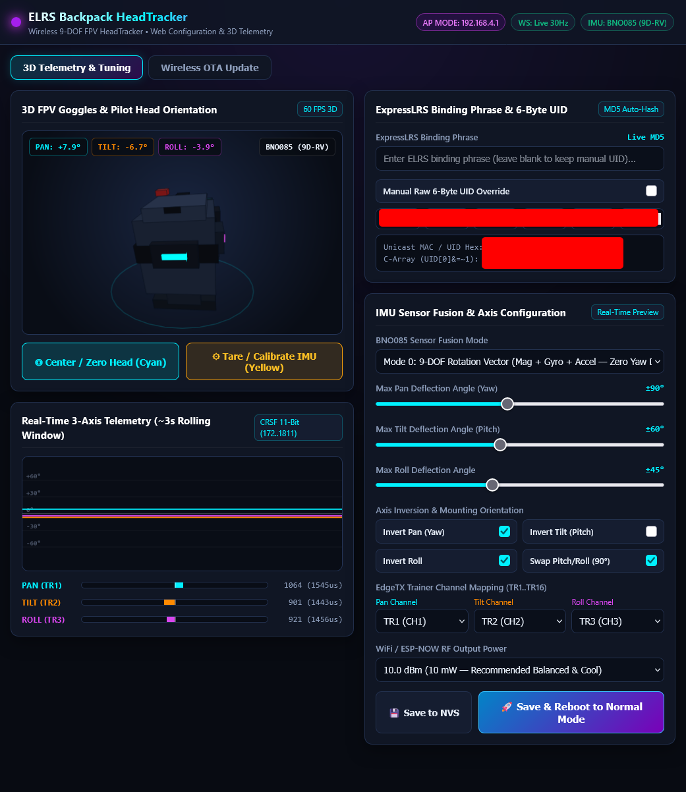

# Project Handoff: FPV HeadTracker via ELRS Backpack (ESP-NOW)

**Primary Target Hardware:** Waveshare ESP32-C3 (with external BNO085 IMU)  
**Secondary Target Hardware:** WEMOS LOLIN S3 Mini Pro (ESP32-S3FH4R2, onboard QMI8658, 0.85" LCD)  
**Base Repository:** [druckgott/ELRS-Backpack-Example-ESPNOW](https://github.com/druckgott/ELRS-Backpack-Example-ESPNOW.git)  
**Communication Protocol:** ExpressLRS Backpack ESP-NOW (`MSP_ELRS_BACKPACK_SET_PTR` / CRSF 11-bit)  
**RC Transmitter Mode:** EdgeTX Trainer (`Master / CRSF`, TR1..TR3)

---

## 1. System Architecture & File Overview

```
ELRS-Backpack-HT/
├── platformio.ini              # Default: esp32c3 (COM20), also supports lolin_s3_mini_pro (COM19)
├── img/
│   ├── HeadTracker_WEBIF_screen.png # Screenshot of the 100% offline Web-IF & 60 FPS 3D Telemetry UI
│   └── Headtracker_debug_screen.png # Screenshot of the USB Serial ASCII level dashboard
├── case/
│   ├── Headtracker-Case_V6.3mf # Ready-to-print 3MF enclosure for Waveshare ESP32-C3 + BNO085
│   └── Headtracker-Case_V6.scad # Parametric OpenSCAD enclosure source (BOSL2)
├── scripts/
│   └── generate_web_assets.py  # Reproducible pre-build generator (HTML5/CSS/JS -> gzipped src/web_assets.h)
├── src/
│   ├── my_config.h            # Central compile-time defaults (UID, pinout, channels, angles, inversion)
│   ├── main.cpp               # Dual-mode boot window, 50Hz ESP-NOW loop, Web-IF mode switch, serial commands
│   ├── headtracker.h / .cpp   # BNO085 (9-DOF/AR-VR/6-DOF) driver, QMI8658 fallback, quaternion math, MD5 UID & NVS
│   ├── web_config.h / .cpp    # SoftAP (192.168.4.1), Captive DNS, mDNS, RFC 6455 WebSocket server, REST & OTA
│   ├── web_assets.h           # Auto-generated gzipped single-file HTML5/CSS/JS + 60 FPS 3D frontend in PROGMEM
│   ├── serial_display.h/.cpp  # Visual ASCII level/horizon meters & status dashboard for headless boards
│   ├── display_manager.h/.cpp # 0.85" LCD driver (ST7789 / GC9A01 auto-detect for S3 Mini Pro)
│   ├── button_manager.h/.cpp  # Interrupt-latched 3-stage button engine & WS2812 RGB LED controller
│   ├── qmi8658.h / .cpp       # Fast I2C driver for onboard 6-axis IMU (fallback)
│   └── fake_vrx_fake_trainer.cpp # Raw 802.11 ESP-NOW packet generator & CRSF frame transmitter
```

---

## 2. Hardware Pinout & Peripherals

### Waveshare ESP32-C3 Pinout
| Peripheral | Pin / Config | Function / Description |
| :--- | :--- | :--- |
| **Microcontroller** | Waveshare ESP32-C3 | Native USB CDC (`COM20`), 160MHz |
| **BNO085 SDA** | **GPIO 4** | I2C Data line (400 kHz) |
| **BNO085 SCL** | **GPIO 5** | I2C Clock line |
| **BNO085 INT** | **GPIO 6** | Active-LOW hardware data-ready interrupt (internal pull-up enabled) |
| **BNO085 RST** | **GPIO 7** | Active-LOW hardware reset |
| **Built-in Switch** | **GPIO 9** | BOOT tactile switch: **Click in 5s Blue Boot** or **Hold $\ge 5.0\text{s}$** = Web-IF AP Mode, **Short Click** ($<1.2\text{s}$) = Center / Zero, **Medium Hold** ($1.2\text{s}..5.0\text{s}$) = Calibrate / Tare |
| **Built-in RGB LED** | **GPIO 10** | WS2812 addressable LED: Pulsing Blue=5s Boot Window, Green=TX OK, Red=TX Error, Breathing Magenta=Web-IF AP, Cyan=Zeroed, Yellow=Calibrated |
| **Display** | *None* | Uses Wi-Fi Web-IF 3D Telemetry Dashboard (`192.168.4.1`) & USB Serial ASCII level bars |

### WEMOS LOLIN S3 Mini Pro Pinout (Legacy / Dual-Target Supported)
| Peripheral | Pin / Config | Notes |
| :--- | :--- | :--- |
| **TFT Display** | MOSI=38, MISO=39, SCLK=40, CS=35, DC=36, RST=34, BL=33 | 0.85" 128x128 ST7789/GC9A01 |
| **Onboard IMU** | SDA=12, SCL=11, Addr=`0x6B` | QMI8658 soldered on bottom of PCB (uses `-az` upward normal reference) |
| **Buttons** | BTN_LEFT=0, BTN_CENTER=47, BTN_RIGHT=48 | Center: Click=Zero, Hold 1.2s=Tare, Hold 5.0s=Web-IF |
| **RGB LED** | PWR=GPIO 7, DATA=GPIO 8 | WS2812 NeoPixel |

---

## 3. Serial Debug Display & Interactive Console

Since compact ESP32-C3 boards do not feature a physical display, the firmware provides a high-refresh **Serial Debug & ASCII Level Dashboard** over native USB CDC at 115200 baud alongside the Wi-Fi Web-IF.

### Interactive Serial Commands:
- `'c'` or **`SPACE`**: Center / Zero head position (matches clicking the BOOT switch).
- `'r'`: Calibrate / Tare the BNO085 IMU.
- `'W'` *(Shift+w)*: Enter **Wi-Fi Web-IF Configuration & 3D Telemetry AP Mode** (`ELRS-HeadTracker-AP` on `192.168.4.1`).
- `'f'`: Cycle IMU Fusion Mode (`9-DOF Mag` <-> `AR/VR 9-DOF` <-> `6-DOF Game RV`).
- `'t'`: Cycle WiFi TX Power (`10dBm` -> `8.5dBm` -> `5dBm` -> `2dBm` -> `19.5dBm` -> `15dBm`).
- `'w'`: Toggle between LIVE HeadTracker and TEST WAVE mode.
- `'m'`: Toggle between **Compact Single-Line** and **Multi-Line Visual Dashboard** display modes.
- `'d'`: Toggle Serial Debug output (Mute / Unmute).
- `'p'`: Toggle Invert Pitch.
- `'s'`: Toggle Swap Pitch & Roll (for rotated 90 deg mounting).
- `'y'`: Toggle Invert Pan / Yaw.
- `'o'`: Toggle Invert Roll.
- `'1'` .. `'3'`: Select Radio Mode (`1`=RX Only, `2`=TX Only, `3`=BOTH bidirectional).
- `'?'` or `'h'`: Display interactive help menu.

### ASCII Level Meters Example:
```
--------------------------------------------------------------------------------
  SENSOR: BNO085 (9D-RV) | PWR: 10.0 dBm | MODE: LIVE-HT   | TX: OK  (#1234) | RX: 56
  PAN  (Yaw)  :  +15.2 deg  [-90] [-------|===----] [+90]  CRSF: 1120 (TR1)
  TILT (Pitch):   -8.4 deg  [-60] [-----===|------] [+60]  CRSF:  901 (TR2)
  ROLL        :   +1.1 deg  [-45] [-------|-------] [+45]  CRSF:  998 (TR3)
--------------------------------------------------------------------------------
```

---

## 4. Built-in LED State Indications & 3-Stage Button Engine

The firmware features an interrupt-latched 3-stage button & LED priority engine (`ButtonManager` in [`src/button_manager.cpp`](src/button_manager.cpp)):
- **Pulsing Blue (`0, 0, 8..120`, ~2 Hz):** 5-second power-up boot window. Clicking the BOOT button (`GPIO 9`) at any point during startup (latched via `FALLING` hardware ISR even during BNO085 I2C initialization) enters Web-IF AP Mode.
- **Breathing Magenta (`#7A00B8` / `122, 0, 184`, ~0.5 Hz quadratic easing):** Wi-Fi Web Configuration AP Mode is active (`ELRS-HeadTracker-AP`).
- **Continuous Green (`0, 40, 0`):** Normal Mode 50 Hz ESP-NOW transmission heartbeat OK.
- **Continuous Red (`40, 0, 0`):** ESP-NOW transmission failure / timeout.
- **Flashing Cyan (`0, 80, 80`, 500ms):** HeadTracker centered / zeroed (triggered via button short click `< 1.2s`, Web-IF button, or serial `'c'`).
- **Solid/Flashing Yellow (`80, 80, 0`):** Lights at `1.2s` while holding the BOOT button; releasing between `1.2s` and `5.0s` (or clicking *Tare IMU* in Web-IF / serial `'r'`) triggers BNO085 hardware tare / calibration.
- **5.0-Second Long Hold (`>= 5.0s`):** Holding the BOOT button past Yellow to `5.0s` flashes Magenta and immediately transitions from Normal Mode into Web-IF Configuration Mode (`BTN_ENTER_WEB_CONFIG`).

---

## 5. Wi-Fi Web-IF, Real-Time 3D Telemetry & Wireless OTA Architecture



### 1. Dual-Mode Operation ([`src/main.cpp`](src/main.cpp) & [`src/web_config.cpp`](src/web_config.cpp))
- **Normal Mode:** Runs the deterministic 50 Hz ESP-NOW transmitter loop (`10.0 dBm` default RF power). SoftAP, DNS, mDNS, and HTTP/WebSocket servers are completely uninitialized for zero background jitter.
- **Web Configuration Mode:** Pauses ESP-NOW transmission, disables Wi-Fi power-save (`WIFI_PS_NONE`), and starts an open SoftAP (`ELRS-HeadTracker-AP`) on `192.168.4.1`, a Captive Portal wildcard DNS server (`*` $\to$ `192.168.4.1`), mDNS responder (`http://headtracker.local`), and HTTP/WebSocket server on port 80. No inactivity timeout is enforced; the device remains in AP mode until the user clicks *Save & Reboot* or power-cycles.

### 2. Reproducible 100% Offline Gzipped Frontend & 60 FPS 3D Renderer ([`scripts/generate_web_assets.py`](scripts/generate_web_assets.py) $\to$ [`src/web_assets.h`](src/web_assets.h))
- The complete single-page HTML5, CSS, JavaScript, client-side MD5 hashing, 3D model geometry, and rolling strip-chart source lives in [`scripts/generate_web_assets.py`](scripts/generate_web_assets.py).
- Hooked into [`platformio.ini`](platformio.ini) via `extra_scripts = pre:scripts/generate_web_assets.py` (and runnable standalone via `python scripts/generate_web_assets.py`), it compresses the frontend with deterministic `gzip -9` (`mtime=0`, `~14.0 KB` in `PROGMEM`) into [`src/web_assets.h`](src/web_assets.h) served with `Content-Encoding: gzip`.
- **30 Hz RFC 6455 WebSocket Stream (`/ws`):** `WebConfigManager` upgrades `/ws` connections on port 80 using `<mbedtls/sha1.h>` + `<mbedtls/base64.h>` and broadcasts JSON telemetry (`pan`, `tilt`, `roll`, `cPan`, `cTilt`, `cRoll`, `sensor`) every `33 ms` (~30 Hz), while accepting instant `{"cmd":"center"}` and `{"cmd":"tare"}` commands from the browser.
- **Rear-Facing 3D Pilot Head & FPV Goggles (`rotatePointEuler`):** The 3D low-poly pilot head, goggle visor, rear strap cushion/battery pack, overhead strap, dual 5.8 GHz antennas, and forward cyan sight beam are rendered from a rear over-the-shoulder perspective (`[-x3, y3, -z3]`, facing away from the viewer into `-Z`) with `yaw = -panDeg`, `pitch = +tiltDeg`, and `roll = +rollDeg` so every movement of the 3D head matches the user's own head from behind.

### 3. Dynamic ExpressLRS Binding Phrase & MD5 UID Hashing
- Both the firmware ([`HeadTracker::computeElrsUid()`](src/headtracker.cpp) via `<mbedtls/md5.h>`) and the Web-IF client JS compute the standard ExpressLRS 6-byte UID:
  $$\text{UID}[0..5] = \text{MD5}(\texttt{"-DMY\_BINDING\_PHRASE=\textbackslash""} + \text{phrase} + \texttt{"\textbackslash""})[0..5], \quad \text{UID}[0] \mathrel{\&=} \sim\texttt{0x01}$$
- Stored in ESP32 NVS (`Preferences` namespace `"elrs_ht"`) alongside all IMU fusion, angle, channel mapping (`TR1..TR16`), inversion, and TX power settings.

### 4. Wireless OTA Firmware Update (`/update`)
- The **Wireless OTA Update** tab streams `.bin` firmware images via `XMLHttpRequest` multipart upload to `/update`, flashing directly to the inactive OTA partition using Arduino `<Update.h>` with live progress reporting and automatic reboot upon completion.

---

## 6. Configuration Reference (`src/my_config.h` / [`src/my_config.h.example`](src/my_config.h.example))

```cpp
// 1. ELRS Binding UID (Generated from your ELRS binding phrase or configured via Web-IF)
#define MY_CUSTOM_UID {0, 0, 0, 0, 0, 0}

// 2. BNO085 Sensor Fusion Mode
// 0 = 9-DOF ROTATION_VECTOR (RECOMMENDED FOR STABLE YAW: Accel + Gyro + Magnetometer, ZERO YAW DRIFT)
// 1 = 9-DOF AR/VR STABILIZED ROTATION VECTOR (Headset-tuned 9-DOF)
// 2 = 6-DOF GAME ROTATION VECTOR (Accel + Gyro only, immune to speaker magnets, but yaw will drift)
#define BNO085_FUSION_MODE 0

// 3. Axis Inversion & 90-Degree Mounting Swap
#define HT_INVERT_PAN       true   // Inverted (Yaw)
#define HT_INVERT_TILT      false  // Non-inverted (Pitch)
#define HT_INVERT_ROLL      true   // Inverted (Roll)
#define HT_SWAP_PITCH_ROLL  true   // Swapped (Sensor mounted rotated by 90 degrees)

// 4. EdgeTX Trainer Channel Mapping (0-indexed: 0=TR1, 1=TR2, 2=TR3)
#define HT_CH_PAN           0   // TR1 = Pan
#define HT_CH_TILT          1   // TR2 = Tilt
#define HT_CH_ROLL          2   // TR3 = Roll

// 5. Max Angle Throws (maps to 172..1811 CRSF)
#define HT_MAX_ANGLE_PAN    90.0f  // +/- 90 degrees
#define HT_MAX_ANGLE_TILT   60.0f  // +/- 60 degrees
#define HT_MAX_ANGLE_ROLL   45.0f  // +/- 45 degrees

// 6. WiFi TX Power (8=2dBm, 20=5dBm, 34=8.5dBm, 40=10dBm, 60=15dBm, 78=19.5dBm)
#define WIFI_TX_POWER_DEFAULT 40   // 10.0 dBm (10 mW) - runs significantly cooler
```

---

## 7. EdgeTX Radio Setup Guide

1. **Model Settings:**
   * **Trainer Mode:** Set to `Master / CRSF`.
2. **Radio Tools $\to$ ExpressLRS Backpack Lua Script:**
   * **HT Enable:** `On`
   * **HT Start Ch:** `EdgeTX` (starts assigning from `TR1`)
   * **Telemetry:** `ESPNOW` (leaves bidirectional telemetry active for RX status).
3. **Model Inputs / Mixer:**
   * Pan camera servo $\to$ Source: `TR1`
   * Tilt camera servo $\to$ Source: `TR2`
   * Roll camera servo $\to$ Source: `TR3`

---

## 8. Flashing & Upload Instructions

The default environment in `platformio.ini` is set to `esp32c3`, and `extra_scripts = pre:scripts/generate_web_assets.py` automatically regenerates `src/web_assets.h` before building.

To manually regenerate `src/web_assets.h` after editing `scripts/generate_web_assets.py`:
```bash
python scripts/generate_web_assets.py
```

To build and upload directly to your Waveshare ESP32-C3:

```bash
pio run -e esp32c3 --target upload
```

To monitor Serial output and interact with the ASCII level meters:
```bash
pio device monitor -e esp32c3
```

---

## 9. 9-DOF Sensor Calculations & Technical Architecture

### 1. BNO085 SparkFun Library INT Pin Hang Bug & Watchdog Recovery
* **Symptom:** ESP32-C3 hangs or enters an infinite reset loop on boot when the BNO085 is connected.
* **Root Cause:** When `intPin` is passed to `_bno.begin(addr, Wire, intPin, -1)`, the underlying SparkFun library executes `hal_wait_for_int()`. If INT is high during startup transactions, it hits a 500ms timeout and triggers `hal_hardwareReset()`, restarting the handshake forever.
* **Solution:** Pass `-1, -1` to `_bno.begin()` in [`src/headtracker.cpp`](src/headtracker.cpp). Pin 7 (RST) is held LOW on boot for 50ms and released with a 300ms stabilization delay before I2C initialization. Pin 6 (INT) has its internal pull-up enabled (`INPUT_PULLUP`) and is used as an active-LOW fast readiness check alongside a 500 Hz non-blocking poll timer. Additionally, `_bno.wasReset()` is monitored in `update()` to automatically re-enable sensor reports if the BNO085 ever experiences an internal reset.

### 2. Gravity-Aligned 3D Relative Quaternions (Zero Cross-Talk on Sloped Goggles)
* **Symptom:** Pitch bleeds into roll (and vice-versa) when turning the head (yaw), especially when the IMU PCB is mounted at an angle on curved FPV goggles.
* **Root Cause:**
  1. Subtracting world Euler angles ($\text{Euler}_{\text{current}} - \text{Euler}_{\text{zero}}$) fails because rotation axes are coupled in 3D space.
  2. Naive body-frame quaternion zeroing ($q_{\text{zero}}^{-1} \otimes q_{\text{current}}$) zeroes inside the tilted PCB frame. If the PCB is mounted at a $25^\circ$ pitch on curved goggles, horizontal head turns around the vertical neck axis (World Gravity $+Z$) bleed $\sin(25^\circ) \approx 42\%$ into Roll and Tilt.
* **Solution:** When `center()` is triggered, the reference orientation $q_0$ is factored into:
  1. **World-Z Azimuth Heading** $q_{\text{yaw},0} = (\cos(\psi_0/2), 0, 0, \sin(\psi_0/2))$ around true Gravity Up ($+Z$).
  2. **Local Goggle Mounting Tilt/Roll** $q_{\text{tilt},0} = q_{\text{yaw},0}^{-1} \otimes q_0$.

  On every update, the 3D relative head orientation is computed as:
  $$q_{\text{rel}} = q_{\text{yaw},0}^{-1} \otimes q_{\text{current}} \otimes q_{\text{tilt},0}^{-1}$$
  - Left-multiplying by $q_{\text{yaw},0}^{-1}$ zeroes horizontal heading around **true World Gravity Up**.
  - Right-multiplying by $q_{\text{tilt},0}^{-1}$ removes the physical mounting slope of the sensor on the goggles.
  - If `HT_SWAP_PITCH_ROLL` (`'s'`) is enabled for $90^\circ$ rotated mounting, an $\text{SO}(3)$ similarity transform $(w, x, y, z) \mapsto (w, -y, x, z)$ is applied **before** Intrinsic $Z\text{-}Y'\text{-}X''$ (`Pan -> Tilt -> Roll`) Euler extraction so the decomposition order always matches the physical camera gimbal.

### 3. Single-Stream Fusion Mode Switching & Asynchronous Tare
* **9-DOF Rotation Vector (`BNO085_FUSION_MODE 0`):** Fuses Accelerometer + Gyroscope + Magnetometer in the ENU frame with background Dynamic Calibration (DCD) for **zero long-term yaw drift**.
* **9-DOF AR/VR Stabilized (`BNO085_FUSION_MODE 1`):** Headset-tuned 9-DOF fusion that suppresses micro-jitter and magnetic swimming during slow/stationary viewing.
* **6-DOF Game Rotation Vector (`BNO085_FUSION_MODE 2`):** Uses only Accelerometer + Gyroscope ($100\%$ immune to speaker/fan magnets, with $\sim 1^\circ\text{--}3^\circ/\text{min}$ yaw drift).
* **Clean Report Switching & Async Tare:** Switching modes via `'f'` or Web-IF explicitly disables inactive SH-2 report IDs (`interval = 0`) and filters incoming packets by the active report ID so 9-DOF and 6-DOF frames never collide. Both mode switches and `'r'` (hardware tare) use a deferred `_pendingCenter` latch that waits for fresh post-tare/post-switch quaternion samples before locking $q_0$.

### 4. Non-Volatile Settings Persistence (NVS)
* Runtime adjustments made via Web-IF or Serial commands (binding phrase, 6-byte UID, fusion mode, max deflection angles, trainer channel mapping `TR1..TR16`, axis inversions, $90^\circ$ pitch/roll swap, and WiFi TX power) are automatically saved to ESP32 NVS (`Preferences` namespace `"elrs_ht"`) and restored on boot.
* A compile-time signature of `src/my_config.h` defaults is stored alongside NVS values so editing `my_config.h` and reflashing automatically updates the stored defaults unless overridden via the Web-IF.

### 5. Board Heating & WiFi Transmission Power
* **Symptom:** The ESP32-C3 feels hot during operation at max TX power ($+19.5\text{ dBm} \approx 89\text{ mW}$).
* **Solution:** `WIFI_TX_POWER_DEFAULT` is set to `40` ($10.0\text{ dBm} = 10\text{ mW}$) in `my_config.h`, reducing RF dissipation by $\approx 89\%$ while maintaining 20+ meters line-of-sight range. Adjustable live via Web-IF or **`'t'`** in the serial monitor (persisted to NVS).

### 6. Telemetry Spam & Anti-Replay Filter
* High-frequency telemetry logs (`LINK`, `VARIO`, `BAT`, `RC Frame`) are set to `LOG_DEBUG` in [`src/application.cpp`](src/application.cpp) to keep the Serial ASCII dashboard clean.
* [`src/fake_vrx_fake_trainer.cpp`](src/fake_vrx_fake_trainer.cpp) injects dynamic 4-byte random salt (`esp_random()`) and transmits via `esp_wifi_80211_tx(..., false)` to satisfy the ExpressLRS backpack anti-replay filter.

