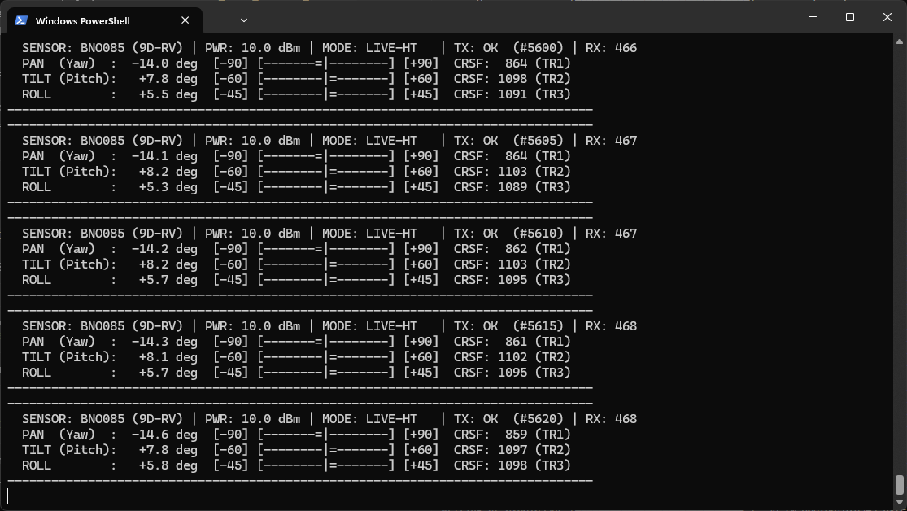
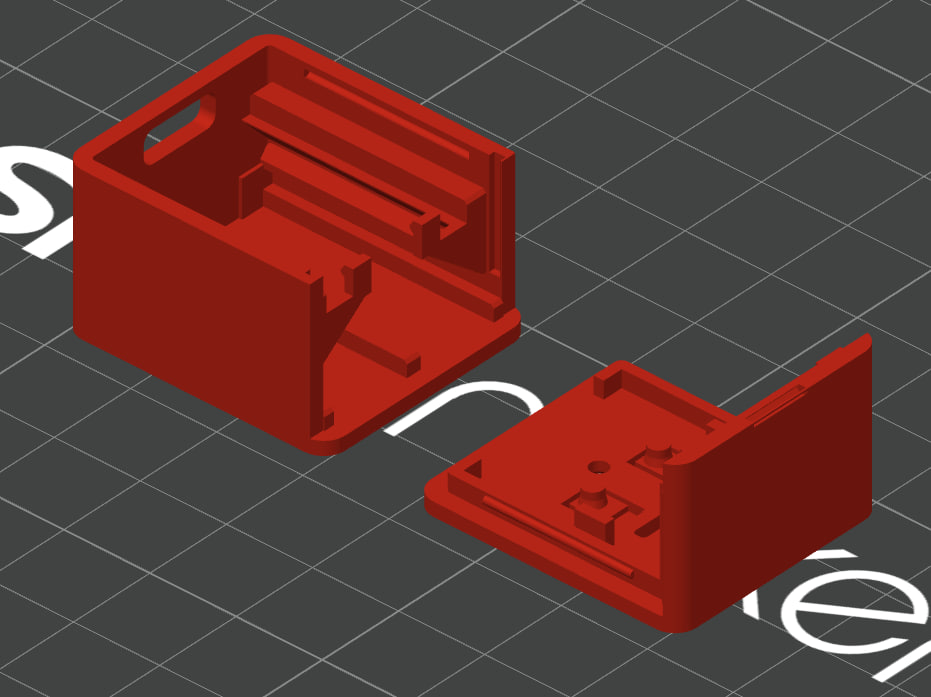
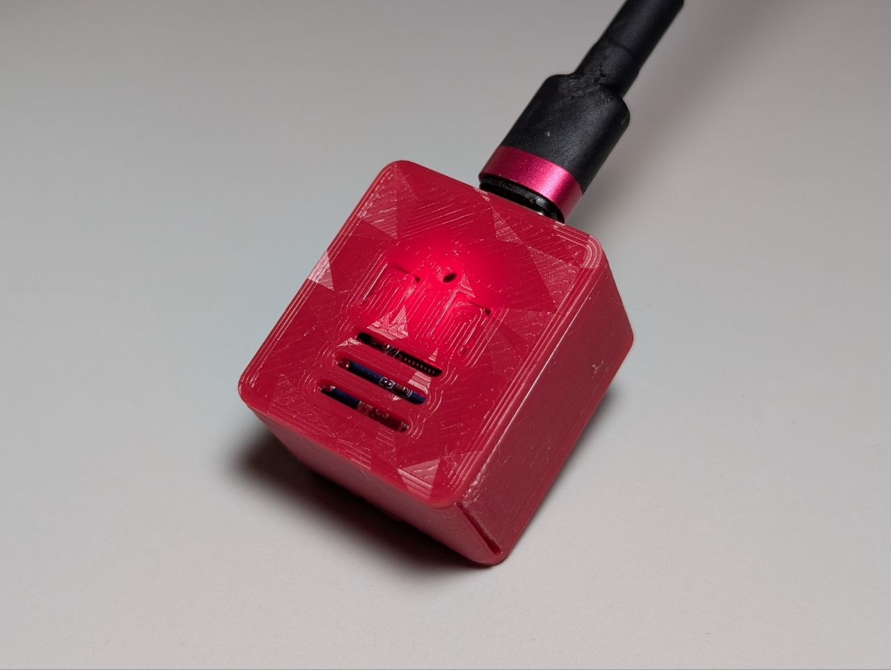

# 🎯 Wireless FPV HeadTracker for ExpressLRS Backpack (ESP-NOW)

[](platformio.ini)
[](src/headtracker.cpp)
[](src/fake_vrx_fake_trainer.cpp)

Jump to: **[🇺🇸 English Documentation](#-english-documentation)** | **[🇩🇪 Deutsche Dokumentation](#-deutsche-dokumentation)**

---

# 🇺🇸 English Documentation

## 📖 Overview

This project turns an **ESP32** and an **IMU sensor** into a **completely wireless, low-latency 3-axis FPV HeadTracker (Pan / Tilt / Roll)** that transmits directly to your **ExpressLRS TX Backpack** over **ESP-NOW** (`MSP_ELRS_BACKPACK_SET_PTR` / 11-bit CRSF Trainer channels `TR1..TR3` at 50 Hz) — **no trainer cable between your FPV goggles and RC radio required!**

It evolved from an ExpressLRS Backpack ESP-NOW example into a full-featured, ready-to-build HeadTracker system including a **100% offline-capable Wi-Fi Web-IF with 60 FPS 3D telemetry & Wireless OTA updates**, dynamic ExpressLRS binding phrase MD5 hashing, a custom 3D-printable goggle case, 9-DOF quaternion math, an interactive USB Serial ASCII dashboard, and non-volatile settings storage.

### 🙏 Credits & Acknowledgments

A huge thank you to **[druckgott](https://github.com/druckgott)** and his original repository **[ELRS-Backpack-Example-ESPNOW](https://github.com/druckgott/ELRS-Backpack-Example-ESPNOW)**, which provided the foundation for bidirectional ESP-NOW communication with the ExpressLRS Backpack, CRSF telemetry decoding, MSP packet framing, and the raw 802.11 TX bypass on ESP32.

---

## ✨ What Was Done / Key Features

* 🌐 **Wi-Fi Web-IF Configuration, Real-Time 3D Telemetry & Wireless OTA:**
  * **100% Offline Self-Contained Portal:** Built-in open SoftAP (`ELRS-HeadTracker-AP`, IP `192.168.4.1`, Captive Portal DNS, and `http://headtracker.local` mDNS) serving a gzipped single-page application directly from flash (`PROGMEM`) — **no internet connection or external CDNs required**.
  * **60 FPS 3D FPV Goggles & Pilot Head Animation:** Pure HTML5 Canvas 3D renderer (rear over-the-shoulder view) and 3-second rolling 3-axis strip chart driven by live **30 Hz WebSocket telemetry** (`ws://192.168.4.1/ws`), plus live 11-bit CRSF channel bars (`172..1811` / `988..2012 us`).
  * **Dynamic ExpressLRS Binding Phrase & MD5 Auto-Hashing:** Enter your plain-text ExpressLRS Binding Phrase directly in the Web UI (or override with a manual 6-byte UID) — automatically computes the 6-byte UID (`MD5("-DMY_BINDING_PHRASE=\"" + phrase + "\"")[0..5]` with unicast bit fix `UID[0] &= ~0x01`) with instant live preview and saves it to NVS.
  * **Live Parameter Tuning:** Adjust BNO085 Sensor Fusion Mode (`0`/`1`/`2`), Max Deflection Angles (Pan/Tilt/Roll), Axis Inversions, $90^\circ$ Pitch/Roll Swap, EdgeTX Trainer Channel Mapping (`TR1..TR16`), and WiFi RF Output Power (`2.0..19.5 dBm`) in real time with a single click to **Save to NVS** or **Save & Reboot**.
  * **Wireless OTA Firmware Updates:** Drag-and-drop a compiled `firmware.bin` directly in the **Wireless OTA Update** tab to flash over Wi-Fi with a live progress bar and automatic reboot.


* 🧭 **9-DOF Sensor Fusion (BNO085) with Zero Yaw Drift:**
  * Primary support for the **Waveshare ESP32-C3-Zero (Mini)** paired with an external **Adafruit / Hillcrest BNO085 9-DOF IMU** over 400 kHz I2C.
  * Three live-selectable fusion modes:
    * `Mode 0`: **9-DOF Rotation Vector** (Accelerometer + Gyroscope + Magnetometer, anchored to magnetic North for **0% long-term yaw drift** with automatic background Dynamic Calibration).
    * `Mode 1`: **9-DOF AR/VR Stabilized Rotation Vector** (headset-tuned 9-DOF fusion that suppresses micro-jitter and magnetic swimming).
    * `Mode 2`: **6-DOF Game Rotation Vector** (Accelerometer + Gyroscope only, 100% immune to magnetic interference from headphone speakers or fans).
* 📐 **Gravity-Aligned 3D Quaternion Math (Zero Axis Cross-Talk):**
  * Uses full 3D quaternion transformations:
    $$q_{\text{rel}} = q_{\text{yaw},0}^{-1} \otimes q_{\text{current}} \otimes q_{\text{tilt},0}^{-1}$$
  * Separates **World-Z azimuth zeroing** (around true Gravity Up) from **local goggle mounting tilt/roll** compensation. Even if the headtracker is mounted at a steep angle on curved FPV goggles, panning your head left/right produces **0% roll or pitch bleed**.
  * Includes an $\text{SO}(3)$ quaternion space $90^\circ$ axis swap (`HT_SWAP_PITCH_ROLL`) prior to Intrinsic $Z\text{-}Y'\text{-}X''$ (`Pan -> Tilt -> Roll`) Euler extraction to support rotated board mounting.
* 🖥️ **Interactive USB Serial Console & Live ASCII Dashboard:**
  * Built-in real-time ASCII horizon/level meters over USB CDC (`115200` baud) for headless boards like the ESP32-C3 — view live angles, CRSF channel values (`TR1..TR3`), packet counters, and toggle axis inversions, fusion modes, WiFi TX power, or launch Web-IF mode (`'W'`) on the fly.
  * All runtime adjustments (`'f'`, `'p'`, `'y'`, `'o'`, `'s'`, `'t'`) and Web-IF settings are automatically saved to **ESP32 NVS (`Preferences`)** so they survive power cycles.



* 🔘 **3-Stage Single-Button Operation & WS2812 RGB Status LED:**
  * **Boot Window (`0 .. 5.0s` after power-up, Pulsing `Blue` LED):** Click the onboard BOOT switch (`GPIO 9`) during the 5-second blue boot pulse to enter **Wi-Fi Web-IF Configuration Mode**.
  * **Short Click (`< 1.2s`)** on the BOOT switch (`GPIO 9`): Center / Zero head position (`Cyan` LED flash).
  * **Medium Hold (`1.2s .. 5.0s`)** on the BOOT switch (`GPIO 9`): LED lights `Yellow` at `1.2s` — release before `5.0s` to trigger Hardware Tare / Calibrate IMU (`Yellow` LED flash).
  * **Long Hold (`>= 5.0s`)** on the BOOT switch (`GPIO 9`): LED switches to `Magenta` at `5.0s` and immediately enters **Wi-Fi Web-IF Configuration Mode** at any time during operation.
  * **Status LED (`GPIO 10`):** Pulsing `Blue` = 5s Boot Window, Solid `Green` = 50 Hz ESP-NOW TX OK, `Red` = TX Error, Breathing `Magenta` (`#7A00B8`) = Web-IF AP Mode active.
* ❄️ **Cool RF Operation (Adjustable WiFi TX Power):**
  * Defaults to `10.0 dBm` (`10 mW`) instead of `19.5 dBm` (`89 mW`), reducing board heat by ~89% while easily covering the 1–2 meter distance between goggles and transmitter. Adjustable live via Web-IF or Serial (`'t'`).
* 💻 **Dual-Hardware Support:**
  * **Target 1 (Default):** **Waveshare ESP32-C3-Zero (Mini)** + external **BNO085** (`env:esp32c3`).
  * **Target 2 (Alternative):** **WEMOS LOLIN S3 Mini Pro** (`env:lolin_s3_mini_pro`) with onboard **QMI8658 6-DOF IMU** and **0.85" 128x128 TFT LCD** (ST7789 / GC9A01 auto-detection).
* 📦 **Custom 3D-Printable Enclosure (`case/`):**
  * Includes a ready-to-print 3MF file ([`case/Headtracker-Case_V6.3mf`](case/Headtracker-Case_V6.3mf)) and parametric OpenSCAD source ([`case/Headtracker-Case_V6.scad`](case/Headtracker-Case_V6.scad)) designed to house both the **Waveshare ESP32-C3-Zero** and **Adafruit BNO085 STEMMA QT** board in a ultra-compact stacked enclosure with integrated BOOT/RESET button plungers, LED viewport, internal PCB retention clip, L-shaped snap lid, and goggle strap / Velcro mount.

---

## 🛠️ How to Build Your Own HeadTracker

### 1. Required Hardware

#### Option A: Primary Build (Recommended — Zero Yaw Drift 9-DOF)
* **Microcontroller:** Waveshare ESP32-C3-Zero (ESP32-C3 Mini with onboard WS2812 RGB LED and USB-C)
* **IMU Sensor:** Adafruit 9-DOF Orientation IMU Fusion Breakout - BNO085 (STEMMA QT / Qwiic) or compatible GY-BNO085 module
* **Case:** 3D-printed enclosure from [`case/Headtracker-Case_V6.3mf`](case/Headtracker-Case_V6.3mf)
* **Wires:** 6 short silicone wires (30 AWG) for I2C + RST/INT

#### Option B: All-in-One Build (6-DOF Onboard IMU + TFT Screen)
* **Board:** WEMOS LOLIN S3 Mini Pro (includes onboard QMI8658 6-axis IMU, 0.85" TFT display, RGB LED, and 3 buttons — no external wiring needed)

---

### 2. Wiring Diagram (Waveshare ESP32-C3 + BNO085)

| BNO085 Pin | Waveshare ESP32-C3 Pin | Function / Notes |
| :--- | :--- | :--- |
| **VIN / 3V3** | **3V3** | 3.3V Power Supply |
| **GND** | **GND** | Common Ground |
| **SDA** | **GPIO 4** | I2C Data (400 kHz) |
| **SCL** | **GPIO 5** | I2C Clock (400 kHz) |
| **INT** | **GPIO 6** | Active-LOW Data Ready Interrupt (internal pull-up enabled) |
| **RST** | **GPIO 7** | Active-LOW Hardware Reset (50ms boot pulse) |

*(Built-in peripherals on the Waveshare ESP32-C3-Zero: **GPIO 9** = BOOT Button, **GPIO 10** = WS2812 RGB LED).*

---

### 3. 3D Printing the Hardware Case (`case/`)

The [`case/`](case) folder contains the custom enclosure specifically engineered for the **Waveshare ESP32-C3-Zero + Adafruit BNO085 STEMMA QT** boards:
* **[`case/Headtracker-Case_V6.3mf`](case/Headtracker-Case_V6.3mf):** Ready-to-slice 3MF project file.
* **[`case/Headtracker-Case_V6.scad`](case/Headtracker-Case_V6.scad):** Parametric OpenSCAD file (uses the [BOSL2 library](https://github.com/BelfrySCAD/BOSL2)) allowing you to customize layout (`stacked` vs. `flat`), goggle strap slots vs. flat Velcro backplate, tolerances, and button plunger length (`1.70 mm`).

| CAD Model & Slicer Preview | Real-Life Assembled HeadTracker Case |
| :---: | :---: |
|  |  |

**Printing & Assembly Tips:**
* Recommended material: **PETG** or **PLA+** with `0.16 mm` or `0.20 mm` layer height, no supports required when printing `base` and `lid` flat on the bed.
* Slide the BNO085 into the lower rail slot first, then snap the ESP32-C3-Zero under the rear retention clip on the upper deck with the USB-C port facing the front opening, and close the L-shaped snap lid.

---

### 4. Configure via Wi-Fi Web-IF (or `my_config.h`)

The ESP32 communicates with your radio's ExpressLRS Backpack using a 6-byte MAC address (`UID`) derived from your **ELRS Binding Phrase**. You can configure your Binding Phrase, UID, and all IMU parameters **wirelessly via the built-in Web-IF** (no re-compilation required) or statically in [`src/my_config.h`](src/my_config.h).

#### Method A: Wireless Web-IF Configuration (Recommended)
1. **Enter Web Configuration Mode** using any of the following triggers:
   * **On Power-Up:** Click the **BOOT button (`GPIO 9`)** while the RGB LED pulses **Blue** during the first 5 seconds after boot.
   * **Anytime During Operation:** Hold the **BOOT button (`GPIO 9`)** for **5 seconds** (LED turns Yellow at `1.2s`, then **Magenta** at `5.0s`).
   * **Via USB Serial:** Send **`W`** (uppercase) in the Serial Monitor.
   * *(If no valid UID is stored yet, the tracker enters Web-IF Mode automatically on boot).*
2. Once the RGB LED breathes **Magenta (`#7A00B8`)**, connect your phone or laptop to the open Wi-Fi hotspot:
   * **SSID:** `ELRS-HeadTracker-AP` *(no password)*
   * **URL:** **[http://192.168.4.1](http://192.168.4.1)** *(or `http://headtracker.local` / automatic Captive Portal pop-up)*
3. Type your **ExpressLRS Binding Phrase** into the Web UI (it automatically computes the 6-byte MD5 UID with live preview), verify the **60 FPS 3D head orientation**, tune your angles/inversions, and click **Save & Reboot to Normal Mode**.

#### Method B: Compile-Time Configuration (`src/my_config.h`)
1. Alternatively, you can obtain your 6-byte `UID` from the **[ExpressLRS Web Flasher](https://expresslrs.github.io/web-flasher/)**:


2. Open [`src/my_config.h`](src/my_config.h) (or copy [`src/my_config.h.example`](src/my_config.h.example)) and set your defaults:

```cpp
// 1. Your ExpressLRS Binding UID
#define MY_CUSTOM_UID {0, 0, 0, 0, 0, 0} // <-- Replace with your 6 numbers (or set via Web-IF)!

// 2. BNO085 Sensor Fusion Mode (0 = 9-DOF Mag, 1 = 9-DOF AR/VR, 2 = 6-DOF Game RV)
#define BNO085_FUSION_MODE  0

// 3. Axis Inversion & 90-Degree Mounting Swap
#define HT_INVERT_PAN       true
#define HT_INVERT_TILT      false
#define HT_INVERT_ROLL      true
#define HT_SWAP_PITCH_ROLL  true   // Set true if sensor is mounted rotated by 90 degrees

// 4. Max Physical Head Deflection Angles (mapped to -100% .. +100% CRSF 172..1811)
#define HT_MAX_ANGLE_PAN    90.0f  // +/- 90 deg (TR1)
#define HT_MAX_ANGLE_TILT   60.0f  // +/- 60 deg (TR2)
#define HT_MAX_ANGLE_ROLL   45.0f  // +/- 45 deg (TR3)
```

---

### 5. Build, Flash & Test via Serial Monitor (or Wireless OTA)

1. Install [VS Code](https://code.visualstudio.com/) with the **PlatformIO IDE** extension.
2. **Web-IF Asset Generation (`scripts/generate_web_assets.py` $\to$ `src/web_assets.h`):**
   * The single-file HTML5/CSS/JS + 3D Canvas Web-IF source lives in [`scripts/generate_web_assets.py`](scripts/generate_web_assets.py), which compresses the frontend with deterministic `gzip -9` (`mtime=0`) into [`src/web_assets.h`](src/web_assets.h) (`PROGMEM`).
   * PlatformIO runs [`scripts/generate_web_assets.py`](scripts/generate_web_assets.py) **automatically** before every build via `extra_scripts = pre:scripts/generate_web_assets.py` in [`platformio.ini`](platformio.ini).
   * If you modify the Web-IF HTML/CSS/JS inside [`scripts/generate_web_assets.py`](scripts/generate_web_assets.py), you can also regenerate [`src/web_assets.h`](src/web_assets.h) manually at any time:
     ```bash
     python scripts/generate_web_assets.py
     ```
3. For the initial USB flash, connect your **Waveshare ESP32-C3** via USB-C (adjust `upload_port` / `monitor_port` in [`platformio.ini`](platformio.ini) if needed) and run:
   ```bash
   pio run -e esp32c3 --target upload
   ```
   *(For subsequent updates, you can simply build with `pio run -e esp32c3` and upload `.pio/build/esp32c3/firmware.bin` wirelessly in the Web-IF **Wireless OTA Update** tab!).*
4. Open the PlatformIO Serial Monitor (`115200` baud):
   ```bash
   pio device monitor -e esp32c3
   ```

#### Interactive Serial Commands

| Key | Action |
| :---: | :--- |
| **`c`** or **`SPACE`** | **Center / Zero** head position to current orientation |
| **`r`** | **Calibrate / Tare** IMU sensor |
| **`W`** *(Shift+w)* | **Enter Wi-Fi Web-IF Configuration & 3D Telemetry AP Mode** (`ELRS-HeadTracker-AP`) |
| **`f`** | **Cycle IMU Fusion Mode** (`9-DOF Mag` $\leftrightarrow$ `AR/VR 9-DOF` $\leftrightarrow$ `6-DOF Game RV`) *(saved to NVS)* |
| **`p`** | **Toggle Invert Pitch / Tilt** *(saved to NVS)* |
| **`y`** | **Toggle Invert Pan / Yaw** *(saved to NVS)* |
| **`o`** | **Toggle Invert Roll** *(saved to NVS)* |
| **`s`** | **Toggle Swap Pitch & Roll** for $90^\circ$ rotated mounting *(saved to NVS)* |
| **`t`** | **Cycle WiFi TX Power** (`10dBm` $\to$ `8.5dBm` $\to$ `5dBm` $\to$ `2dBm` $\to$ `19.5dBm` $\to$ `15dBm`) *(saved to NVS)* |
| **`m`** | **Toggle Serial Display Mode** (`Compact Single-Line` $\leftrightarrow$ `Visual ASCII Dashboard`) |
| **`w`** | **Toggle Test Wave Mode** (`LIVE HeadTracker` $\leftrightarrow$ `TEST WAVE` sine generator) |
| **`d`** | **Mute / Unmute** periodic Serial output |
| **`1` .. `3`** | **Select Radio Mode** (`1` = RX Only, `2` = TX Only, `3` = Bidirectional BOTH) |
| **`?`** or **`h`** | Display help menu |

---

### 6. ExpressLRS Backpack & EdgeTX Transmitter Setup

Official ExpressLRS Trainer Input documentation: https://www.expresslrs.org/software/trainer-input/

#### A. ExpressLRS TX Backpack Settings
1. Ensure your TX Backpack runs **ExpressLRS Backpack firmware v1.5.1+** with the **same Binding Phrase / UID**.
2. In the **ExpressLRS Lua Script** (or Backpack Web UI), configure:
   * **Backpack:** `On`
   * **Telemetry:** `ESPNOW` (enables ESP-NOW link)
   * **HT Enable:** `On`
   * **HT Start Ch:** `EdgeTX` (outputs headtracking on `TR1`, `TR2`, `TR3`)


#### B. EdgeTX Model Settings
1. Open **Model Setup** $\to$ **Trainer** and set **Mode** to **`Master / CRSF`**.
2. Map **`TR1` (Pan)**, **`TR2` (Tilt)**, and **`TR3` (Roll)** in your **Inputs / Mixes** to your camera gimbal servo channels:


> [!TIP]
> **Troubleshooting Trainer Detection in EdgeTX:**
> Sometimes EdgeTX receives telemetry via ESP-NOW, but does not immediately lock onto the `Master / CRSF` trainer stream. Re-selecting `Master / CRSF` in the Model Setup or toggling `HT Enable` (`Off` $\to$ `On`) in the ExpressLRS Backpack Lua script resolves this immediately.

---

# 🇩🇪 Deutsche Dokumentation

## 📖 Übersicht

Dieses Projekt verwandelt einen **ESP32-C3** und einen **9-DOF IMU-Sensor (BNO085)** in einen **komplett kabellosen 3-Achsen FPV-HeadTracker (Pan / Tilt / Roll)**, der seine Kanaldaten direkt per **ESP-NOW** (`MSP_ELRS_BACKPACK_SET_PTR` / 11-Bit CRSF Trainer-Kanäle `TR1..TR3` mit 50 Hz) an das **ExpressLRS TX-Backpack** der Fernsteuerung überträgt.

Das Projekt basiert auf dem ESP-NOW Bridge-Beispiel von **[druckgott](https://github.com/druckgott/ELRS-Backpack-Example-ESPNOW)** (vielen Dank für die großartige Vorarbeit bei der ESP-NOW / CRSF / Raw-802.11-Implementierung!) und wurde zu einem vollwertigen HeadTracker-System inkl. **100% offline-fähigem Wi-Fi Web-Interface mit 60 FPS 3D-Echtzeit-Telemetrie & Wireless OTA-Updates**, dynamischer ELRS Binding-Phrase MD5-Generierung, 3D-druckbarem Gehäuse, gravitationsausgerichteter 3D-Quaternionen-Mathematik und interaktivem Serial-Dashboard ausgebaut.

---

## ✨ Neuerungen & Features

* 🌐 **Wi-Fi Web-Interface, 3D-Echtzeit-Telemetrie & Wireless OTA:**
  * **100% Offline-fähiges Web-Portal:** Integrierter WLAN-Access-Point (`ELRS-HeadTracker-AP`, IP `192.168.4.1`, Captive Portal DNS sowie `http://headtracker.local` mDNS), komplett komprimiert im Flash-Speicher (`PROGMEM`) abgelegt — **keine Internetverbindung nötig**.
  * **60 FPS 3D FPV-Brillen & Pilotenkopf-Animation:** Reine HTML5-Canvas 3D-Darstellung (Ansicht von hinten über die Schulter) sowie ein 3-Sekunden Echtzeit-Liniendiagramm per **30 Hz WebSockets** (`ws://192.168.4.1/ws`) inkl. 11-Bit CRSF-Kanalbalken (`172..1811`).
  * **Dynamische ExpressLRS Binding-Phrase & MD5-Hashing:** Einfach die ExpressLRS Binding-Phrase im Klartext eingeben — die 6-Byte `UID` wird live per MD5 berechnet (oder manuell überschrieben) und dauerhaft im NVS gespeichert.
  * **Echtzeit-Konfiguration:** Fusions-Modus (`0`/`1`/`2`), Maximalwinkel (Pan/Tilt/Roll), Achsen-Invertierungen, $90^\circ$ Pitch/Roll-Tausch, EdgeTX Trainer-Kanalzuordnung (`TR1..TR16`) und WLAN-Sendeleistung (`2.0..19.5 dBm`) bequem im Browser einstellen.
  * **Kabelloses OTA Firmware-Update:** Neue `firmware.bin`-Dateien direkt über den Tab **Wireless OTA Update** per WLAN flashen.


* 🧭 **Driftfreies 9-DOF Tracking mit dem BNO085:**
  * Unterstützt den kompakten **Waveshare ESP32-C3-Zero (Mini)** mit externem **Adafruit / Hillcrest BNO085 9-DOF Sensor** über 400 kHz I2C.
  * 3 umschaltbare Fusions-Modi (`9-DOF Rotation Vector` mit Magnetometer für **0% Yaw-Drift**, `9-DOF AR/VR Stabilized` für Videobrillen, sowie `6-DOF Game Rotation Vector` ohne Magnetometer).
* 📐 **Gravitationsausgerichtete 3D-Quaternionen-Berechnung (0% Achsen-Übersprechen):**
  * Berechnet die relative Kopfbewegung über:
    $$q_{\text{rel}} = q_{\text{yaw},0}^{-1} \otimes q_{\text{current}} \otimes q_{\text{tilt},0}^{-1}$$
  * Dadurch bleibt die horizontale Drehachse (Pan) immer exakt an der echten Schwerkraft-Hochachse ausgerichtet, während die Einbauneigung an gewölbten FPV-Brillen automatisch herausgerechnet wird — **kein Übersprechen (Cross-Talk) zwischen Pan, Tilt und Roll**, selbst bei schräger Montage!
  * Unterstützt $90^\circ$ gedrehten Einbau (`HT_SWAP_PITCH_ROLL`) direkt im Quaternionen-Raum.
* 🖥️ **Interaktives USB-Serial ASCII-Dashboard & NVS-Speicherung:**
  * Echtzeit-Wasserwaage / Balkenanzeige über USB-Serial (`115200` Baud) für Boards ohne eigenes Display (siehe [`img/Headtracker_debug_screen.png`](img/Headtracker_debug_screen.png)).
  * Alle im Web-IF oder per Tastendruck im Serial-Monitor geänderten Einstellungen werden automatisch dauerhaft im **ESP32 Flash (NVS)** gespeichert.
* 🔘 **3-Stufen Ein-Tasten-Bedienung & RGB-Status-LED:**
  * **Boot-Fenster (`0 .. 5.0s` nach dem Einschalten, pulsierende `Blaue` LED):** Klick auf den BOOT-Taster (`GPIO 9`) startet den **Wi-Fi Web-IF Konfigurationsmodus**.
  * **Kurzer Klick (`< 1.2s`)** auf den BOOT-Taster (`GPIO 9`): HeadTracker zentrieren / nullen (`Cyan` LED-Blinken).
  * **Mittlerer Druck (`1.2s .. 5.0s`)** auf den BOOT-Taster (`GPIO 9`): LED leuchtet ab `1.2s` `Gelb` — Loslassen vor `5.0s` kalibriert den Sensor / Tare (`Gelb` LED-Blinken).
  * **Langer Druck (`>= 5.0s`)** auf den BOOT-Taster (`GPIO 9`): LED wechselt bei `5.0s` auf `Magenta` und startet sofort den **Wi-Fi Web-IF Konfigurationsmodus** im laufenden Betrieb.
  * **Status-LED (`GPIO 10`):** Pulsierend `Blau` = 5s Boot-Fenster, `Grün` = 50 Hz ESP-NOW Senden OK, `Rot` = Sendefehler, Atmendes `Magenta` (`#7A00B8`) = Web-IF AP-Modus aktiv.
* 📦 **3D-Druck-Gehäuse im Ordner [`case/`](case):**
  * Druckfertige 3MF-Datei ([`case/Headtracker-Case_V6.3mf`](case/Headtracker-Case_V6.3mf)) sowie parametrisches OpenSCAD-Modell ([`case/Headtracker-Case_V6.scad`](case/Headtracker-Case_V6.scad)) für **Waveshare ESP32-C3-Zero + Adafruit BNO085 STEMMA QT** mit integrierten Taster-Stößeln, LED-Sichtfenster, Platinen-Schnappclip, L-Deckel und Klett-/Kopfband-Halterung.

---

## 🛠️ Eigenen HeadTracker nachbauen (Schritt-für-Schritt)

### 1. Verkabelung (Waveshare ESP32-C3-Zero + BNO085)

| BNO085 Pin | Waveshare ESP32-C3 Pin | Funktion |
| :--- | :--- | :--- |
| **VIN / 3V3** | **3V3** | 3.3V Stromversorgung |
| **GND** | **GND** | Masse (GND) |
| **SDA** | **GPIO 4** | I2C Datenleitung (400 kHz) |
| **SCL** | **GPIO 5** | I2C Taktleitung (400 kHz) |
| **INT** | **GPIO 6** | Interrupt-Leitung (Active-LOW, interner Pull-Up aktiv) |
| **RST** | **GPIO 7** | Hardware-Reset (Active-LOW) |

*(Alternativ wird auch das **WEMOS LOLIN S3 Mini Pro** mit integriertem QMI8658 6-Achsen-Sensor und 0.85" TFT-Display über das PlatformIO-Environment `lolin_s3_mini_pro` unterstützt).*

### 2. Gehäuse drucken (`case/`)
* Drucke [`case/Headtracker-Case_V6.3mf`](case/Headtracker-Case_V6.3mf) aus PETG oder PLA+ (Schichthöhe `0.16 mm`–`0.20 mm`, kein Support nötig).
* Zuerst den BNO085 in die untere Führungsschiene einschieben, danach den ESP32-C3-Zero oben unter den hinteren Halteclip drücken und den L-Deckel aufclipsen.

| 3D-Modell & Slicer-Ansicht | Fertig aufgebautes Gehäuse im Einsatz |
| :---: | :---: |
|  |  |

### 3. Firmware bauen, flashen & per Web-IF (oder `my_config.h`) konfigurieren
1. **Web-IF Assets & Reproduzierbarer Build (`scripts/generate_web_assets.py`):**
   * Der gesamte Quellcode des Web-Interfaces (HTML5, CSS, JS, 3D-Renderer) befindet sich in [`scripts/generate_web_assets.py`](scripts/generate_web_assets.py) und wird automatisch bei jedem PlatformIO-Build (`extra_scripts = pre:scripts/generate_web_assets.py` in [`platformio.ini`](platformio.ini)) deterministisch mit `gzip -9` in die Header-Datei [`src/web_assets.h`](src/web_assets.h) (`PROGMEM`) komprimiert.
   * Bei Änderungen am Web-Interface kann [`src/web_assets.h`](src/web_assets.h) jederzeit auch manuell neu generiert werden:
     ```bash
     python scripts/generate_web_assets.py
     ```
2. Mit PlatformIO erstmalig per USB-C kompilieren und flashen:
   ```bash
   pio run -e esp32c3 --target upload
   ```
   *(Spätere Firmware-Updates können einfach mit `pio run -e esp32c3` kompiliert und über den Tab **Wireless OTA Update** als `.pio/build/esp32c3/firmware.bin` kabellos per WLAN eingespielt werden).*
3. **Web-Interface starten:** Entweder während der ersten 5 Sekunden nach dem Einschalten (pulsierende blaue LED) kurz auf den **BOOT-Taster (`GPIO 9`)** klicken, im laufenden Betrieb den **BOOT-Taster für 5 Sekunden gedrückt halten** (LED wechselt von Gelb auf Magenta) oder im Serial Monitor **`W`** senden.
4. Mit dem offenen WLAN **`ELRS-HeadTracker-AP`** verbinden und **[http://192.168.4.1](http://192.168.4.1)** (bzw. `http://headtracker.local`) öffnen.
5. Eigene **ExpressLRS Binding-Phrase** eintragen (6-Byte `UID` wird automatisch berechnet), im 3D-Modell die Wirkrichtungen prüfen und auf **Save & Reboot to Normal Mode** klicken.

### 4. EdgeTX & ELRS Backpack einrichten
1. Im **ExpressLRS Backpack Lua-Script** (bzw. Web-UI):
   * **Telemetry:** `ESPNOW`
   * **HT Enable:** `On`
   * **HT Start Ch:** `EdgeTX`
2. In **EdgeTX Model Setup**:
   * **Trainer Mode:** `Master / CRSF`
   * In den **Inputs / Mischern** die Quellen **`TR1` (Pan)**, **`TR2` (Tilt)** und **`TR3` (Roll)** den jeweiligen Servo-Kanälen zuweisen.

Weitere technische Details zur Architektur, dem Web-Server und den 9-DOF Quaternionen-Berechnungen befinden sich in **[HANDOFF.md](HANDOFF.md)**.
